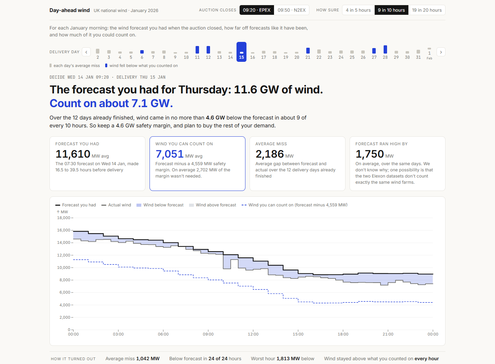
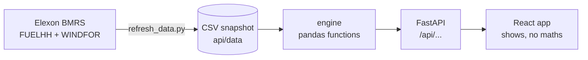

# tvk7r

[](https://github.com/parthtiwari-dev/tvk7r/actions/workflows/ci.yml)

UK wind forecast monitor for a day-ahead trading team: **the wind forecast you had when you had
to decide, and how far off forecasts like it have been.**

**Live app: https://tvk7r.vercel.app**



## What it answers

A UK utility buys power on the day-ahead market the morning before delivery. Wind will cover
part of tomorrow's demand, but only a forecast of it is known when they buy. For each delivery
day in the pilot, the app shows:

1. **The forecast you had.** For each hour of the delivery day, the newest Elexon wind forecast
   published **strictly before** the auction cutoff (09:20 UK for EPEX, or 09:50 for N2EX).
   Nothing published later is ever used.
2. **How much of it you can count on.** The forecast minus a safety margin, sized from how far
   past forecasts fell short: you choose how sure you want to be (4 in 5, 9 in 10 or 19 in 20
   hours). Next to it, the average miss and how far the forecast has run high. The top of the
   screen uses only delivery days already finished that morning; the "January in review"
   section below uses the whole month and says so.
3. **How it turned out.** Forecast against actual, half-hour by half-hour, with the gap shaded
   and a dashed "wind you can count on" line. A small bar per day shows each day's miss and
   marks the days wind fell below what you counted on.

It does not say how much power to buy: demand is outside the data in scope. The team buys the
rest of their demand beyond the wind they can count on.

## How to run

**With Docker** (from this folder):

```
docker compose up --build
```

Then open http://localhost:8080. Two containers: `api` (FastAPI on uvicorn) and `web` (the built
React app on nginx, which also forwards `/api` to the API, the same way Vercel does).

**Without Docker**, in two terminals:

```
cd api                                 # Python 3.13
pip install -r requirements-dev.txt
python -m pytest                       # 44 tests
uvicorn app:app --reload               # API on http://127.0.0.1:8000 (docs at /docs)
```

```
cd web                                 # Node 20.19+ or 22.12+
npm install
npm test                               # 16 tests
npm run dev                            # app on http://localhost:5173 (forwards /api to port 8000)
```

To re-pull the data from Elexon: `python scripts/refresh_data.py` from `api/`.

## Files and folders

```
api/                      back end (Python, FastAPI, pandas)
  app.py                  the four endpoints; loads the snapshot once
  snapshot.py             reads data/ into DataFrames
  engine/                 the logic: pure functions, no web code, no file reading
    clean.py              drop duplicate rows and hours already past when published
    forecast.py           the forecast you had at the cutoff; hourly actuals; UK time rules
    accuracy.py           typical miss, bias, cover levels, extra side, worst days, lead time
  data/                   the snapshot: actuals.csv, forecasts.csv, meta.json (about 1 MB)
  scripts/refresh_data.py re-pulls from Elexon, checks the data, rewrites data/
  tests/                  pytest: edge cases on small hand-made tables + the real snapshot
  Dockerfile
web/                      front end (React, TypeScript, Vite, Observable Plot)
  src/App.tsx             the screen: holds the chosen day, cutoff and risk; loads data
  src/api.ts              the API's JSON shapes and one fetch per endpoint
  src/format.ts           UK time and MW formatting
  src/story.ts            turns API numbers into what the screen says
  src/components/         controls, day view, hero chart, January review, lead-time chart
  Dockerfile, nginx.conf  build, then serve with nginx
docker-compose.yml        runs both containers
vercel.json               Vercel: build web/, serve it, send /api/* to api/app.py
.github/workflows/ci.yml  CI: both test suites, lint, build, Docker check
docs/screenshot.png
CLAUDE.md                 the project rules given to the AI coding tool
```

## How it works



- **No lookahead.** `forecast_you_had` in `api/engine/forecast.py` takes, for each hour, the
  newest forecast with `publishTime` strictly before the cutoff. A forecast published at exactly
  09:20 is too late. If the newest publish skipped an hour, that hour falls back to the one
  before; if nothing was published before the cutoff, the hour stays empty. Tests cover each case.
- **Error = forecast minus actual.** Positive means wind came in below forecast, so you are
  short. The safety margin (called `cover` in the code) is sized from the short side only: the
  80th, 90th or 95th percentile of the error. Wind you can count on = forecast minus the margin.
- **Two honest views.** "That morning" numbers use only delivery days fully over before the
  decision; a test checks a later day never leaks in. On Fri 2 Jan there is no past day, so the
  app says there is no track record yet rather than inventing a number.
- **Endpoints:** `/api/health`, `/api/days`, `/api/day/{YYYY-MM-DD}?cutoff=HH:MM`,
  `/api/accuracy?cutoff=HH:MM`. Times out in UTC; the front end shows UK time.
- **Computed on request** (then cached per cutoff), so the cutoff control works without
  pre-computing every combination.
- The front end computes no metrics: every number comes from the engine, so two places can't
  disagree. It only formats them and subtracts the margin from the forecast to draw "wind you
  can count on".

## Data notes

- **Window:** decisions made 1 to 31 January 2026, so delivery days 2 January to 1 February
  2026. Forecasts published from 29 December are in the snapshot so the early days have one.
- **Hours vs half-hours.** Forecasts are hourly; actuals are half-hourly. Each hourly forecast is
  paired with the average of the two half-hours that **start** at that hour (the plain reading of
  `startTime`, as the brief gives it). Reading it as hour-ending fits the data about 2% better;
  small next to the bias below, so we kept the plain reading.
- Each forecast publish also repeats hours already past. Those rows are dropped: they are not
  forecasts.
- **The forecast ran high.** Over January the forecast you had at 09:20 was on average 1.7 GW
  above the actual (the actual averaged 11.3 GW, so about 15%). The app shows this as its own number. We don't know why; one
  possibility is that the two Elexon datasets don't count exactly the same wind farms. This is
  not confirmed.
- UK time equals UTC all January. The code still converts with real UK time rules (tested on
  summer time and clock-change days).

## Tests and CI

- `api/`: 44 pytest tests. Edge cases on small hand-made tables (nothing before the cutoff, a
  publish exactly at and just after the cutoff, a skipped hour, duplicates, past-hour rows,
  summer time and clock-change days, a missing half-hour, the past-days rule, each metric
  against numbers worked by hand), plus a cross-check against numbers worked out separately on
  the real snapshot.
- `web/`: 16 Vitest tests for UK time, number formats, the headline, "count on" and chart rows.
- GitHub Actions runs on every push and pull request: pytest; lint, tests and build for the web
  app; and a Docker job that builds both containers, starts them and checks the API, a day and
  the page answer through nginx.

## Deploy

On Vercel, from GitHub: every push to `main` deploys. The React app is served as static files;
`api/app.py` runs as one Python function with the CSV snapshot bundled in (about 51 MB).
COLD_START_PLACEHOLDER

## AI tools used

Built with **Claude Code** (Anthropic's AI coding tool), which wrote most of the code. The
decisions were mine: what "the forecast you had" means and where the cutoff sits, sizing the
safety margin from the short side, keeping "that morning" and "January in review" apart, saying
it in the client's words ("wind you can count on"), how the screen looks.
`CLAUDE.md` holds the rules the tool worked under. The engine's numbers were checked against
figures worked out separately before any code was written.

## Known limits

- January 2026 only, from a snapshot. The refresh script can re-pull it; other months would need
  the date window in `app.py` widened.
- No demand data, so the app gives the wind you can count on, not a purchase volume.
- National wind only, as the brief scopes it.
